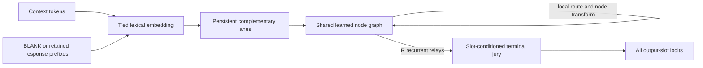

# Gator Architecture Specification

**Status:** Living technical specification  
**Architecture family:** Graph Trace Relay (GTR / Gator)
**Current primary implementation:** Convergent Gator
**Current language curriculum:** Causal prefix denoising toward unsupported
simultaneous formation
**Last updated:** July 20, 2026

## 1. Scope

Gator is a recurrent graph-routing architecture intended to form all positions
of a structured output together. It separates two notions of time:

- **Sequence position:** the immutable coordinate of a context token or output
  slot.
- **Relay depth:** the number of internal graph-processing steps already
  completed.

All sequence positions and all persistent payload lanes update in parallel
inside one relay. Relays remain sequential because relay `r + 1` consumes the
state and graph location produced by relay `r`.

The current Convergent implementation no longer treats a replicated
four-node "cell" as the fundamental unit. It uses one shared graph containing
many learned nodes and carries several complementary payload lanes through
that graph. Each lane preserves its own semantic state and probabilistic graph
location. Lanes interact when their tokens occupy the same graph nodes, then a
learned terminal jury combines the surviving lane representations.



The architecture does not store, rank, or retrieve complete routes such as
`A1 -> B3 -> C5`. A route emerges from repeated local choices:

```text
current payload + local memory + occupancy + address
                         |
                         v
               choose one-hop destinations
                         |
                         v
            transform at destination nodes
                         |
                         v
             carry state into the next relay
```

Training adjusts the local router, node, lane, and readout weights according to
end-task loss. A familiar packet can therefore acquire a stable path without a
separate route memory.

## 2. Architectural contract

A model belongs to the current Gator family when it preserves these
invariants:

1. Output slots are represented together and can be decoded in one forward
   pass.
2. Mutable payload state persists across recurrent relays.
3. A graph-location state persists with each payload.
4. Every handoff is a local source-to-destination decision over legal graph
   edges.
5. Co-located tokens or lanes can affect one another through node memory or an
   equivalent local interaction.
6. Destination nodes apply learned local transformations.
7. Output-slot addresses are immutable and are reintroduced during routing,
   computation, and readout.
8. Complete routes are not explicit learned objects.

The current **Convergent Gator** additionally requires:

1. One shared node graph rather than replicated independent cell graphs.
2. Several persistent complementary payload lanes.
3. Shared graph-node parameters with lane-specific lexical and adapter views.
4. Explicit learned fusion of the final lane representations.

Parallel output formation and teacher forcing are separate properties. In
teacher-forced mode, all response positions are evaluated in parallel, but
position `i` receives the correct earlier response tokens through a causal
mask. Novel generation from that mode remains autoregressive. Unsupported
simultaneous formation means that no correct earlier response token is supplied
to any output slot.

## 3. Names

- **Graph Trace Relay (GTR):** the general mechanism of persistent graph
  location, recurrent local routing, graph-mediated interaction, and
  node-local computation.
- **Gator:** the architecture family.
- **Convergent Gator:** the current primary implementation: one shared graph
  plus persistent complementary payload lanes.
- **Lane:** one persistent semantic trace for every token or output slot. A
  lane is not a graph node and is not a replicated vocabulary head.
- **Node:** a learned graph location with a local transformation and router
  row.
- **Relay:** one synchronous graph-routing and transformation update.
- **Formation:** the complete set of output slots.
- **Arrow / GTR-ARW:** the earlier address-anchored,
  relation-aware, controlled-writing four-node cell.
- **Gator-S:** the earlier explicit macro-cell stewardship branch. It remains
  implemented for research but is not the current primary model.

Current configuration notation:

```text
GATOR-CONV-D20-N66-L10-K3-R2-SW50-SLOTVOTE-E32-V2048
```

| Field | Meaning |
|---|---|
| `D20` | mutable payload width 20 |
| `N66` | 66 shared graph nodes |
| `L10` | ten persistent complementary lanes |
| `K3` | three legal outgoing destinations per node |
| `R2` | two recurrent relays |
| `SW50` | deterministic small-world graph with 50% shortcut rewiring |
| `SLOTVOTE` | prompt-and-address-dependent lane fusion per output slot |
| `E32` | width-32 tied lexical embedding |
| `V2048` | 2,048-piece vocabulary |

## 4. Current reference configurations

The active language controls change payload width while freezing the remaining
architecture.

| Setting | D20 control | D400 control |
|---|---:|---:|
| Vocabulary `V` | 2,048 | 2,048 |
| Lexical width `E` | 32 | 32 |
| Payload width `D` | 20 | 400 |
| Shared nodes `N` | 66 | 66 |
| Persistent lanes `L` | 10 | 10 |
| Outgoing degree `K` | 3 | 3 |
| Relays `R` | 2 | 2 |
| Connection layout | small world | small world |
| Rewire probability | 0.50 | 0.50 |
| Terminal vote | slot-conditioned | slot-conditioned |
| Context slots | 512 | 512 |
| Response slots | 128 | 128 |
| Batch size | 8 | 8 |
| Trainable parameters | **130,442** | **14,360,682** |

Both controls use:

- graph seed 0;
- ten evenly spaced starting nodes
  `[0, 6, 13, 19, 26, 33, 39, 46, 52, 59]`;
- a tied lexical table;
- lane-specific input and output projections;
- a scored non-rendering `BLANK` token;
- forbidden response logits for `PAD`, `BOS`, `MASK`, `USER`, and
  `ASSISTANT`;
- FP32 matmul precision `high` and cuDNN TF32 on the Blackwell control runs.

The reference graph preserves self and directed `+1` edges. At 50% rewiring,
each third edge is independently either the ring predecessor or a deterministic
nonlocal shortcut. The connection table is fixed by seed and checkpointed; it
does not consume trainable parameters.

For degree three and two relays, each lane can reach at most:

```text
before relay 1: 1 node
after relay 1:  3 nodes
after relay 2:  7 nodes
```

Those counts are exact for the current seed-zero graph. The ten lane
frontiers can overlap, allowing cross-lane interaction before terminal fusion.

## 5. Persistent state

Let:

- `B` be batch size;
- `T = C + O` be context plus output positions;
- `L` be persistent lanes;
- `D` be payload width;
- `N` be graph nodes;
- `K` be outgoing graph degree.

The principal tensors are:

| Tensor | Shape | Meaning |
|---|---|---|
| `H` | `[B, T, L, D]` | mutable payload state |
| `Q` | `[B, T, L, N]` | persistent probabilistic node location |
| `A` | `[T, 4]` | fixed immutable address code |
| `M` | `[B, T, N, D]` | receiver-specific graph-node memory |
| `Dest` | `[N, K]` | fixed legal one-hop destinations |
| `P` | `[B, T, L, S, K]` | local transition probabilities for currently reachable source nodes |
| `W_term` | `[B, O, L]` in slot mode | final per-slot lane contribution |

`S` is the maximum number of nodes reachable by one lane at the current relay.
The implementation keeps `Q` on the full node axis for exact accumulation but
evaluates router rows and destination transforms only for structurally
reachable nodes when `reachable_node_execution=True`.

Each token position therefore carries several complementary graph traces:

\[
h_{b,i,\ell}^{(r)} \in \mathbb{R}^{D},
\qquad
q_{b,i,\ell}^{(r)} \in \Delta^{N-1}.
\]

`H` and `Q` are carried forward. They are not reconstructed from the original
input between relays.

## 6. Input and immutable addresses

The language shell stores one trainable lexical table:

\[
E_{tok} \in \mathbb{R}^{V \times E}.
\]

It is tied to the final vocabulary projection. Each lane gets its own learned
input view:

\[
h_{b,i,\ell}^{(0)}
=W^{in}_{\ell}E_{tok}[x_{b,i}] + W^{addr}_{\ell}a_i.
\]

This avoids the old failure mode in which every specialist received the same
narrow projection of a wider lexical state. The large vocabulary is shared,
but every lane can extract a different width-`D` view.

Observed context positions use their actual token IDs. Output positions use
either:

- the non-rendering `BLANK` embedding for unsupported formation; or
- shifted, causally available response tokens under teacher forcing or prefix
  denoising.

The address `a_i` is fixed. It is injected into:

1. initial lane state;
2. local edge logits;
3. every relay computation;
4. terminal readout.

It is never averaged into graph memory or updated by a node transform.

The legacy/default starting locations are deterministic and lane-separated:

\[
start_\ell = \left\lfloor \frac{\ell N}{L} \right\rfloor.
\]

With `ingress_mode=fixed`, `Q` begins as one-hot at these starting nodes. The
ingress node before relay one is fixed by lane. The first destination is
content-conditioned, but the model cannot initially choose any node in the
population.

This fixed ingress is a known scaling limitation. When node count grows faster
than lane count, degree, or relay depth, many purchased nodes can lie outside
every lane's structural frontier and receive no task gradient.

The opt-in `ingress_mode=learned` instead uses the shared routing trunk and a
private key and bias for every possible first steward:

\[
z^{ingress}_{b,i,\ell}
=
\operatorname{GELU}
\left(
W^{route}_{h}h_{b,i,\ell}+b^{route}
\right),
\]

\[
q_{b,i,\ell,n}^{(0)}
=
\operatorname{softmax}_n
\left(
\frac{
\langle z^{ingress}_{b,i,\ell},k^{ingress}_n\rangle
+b^{ingress}_n
}{\tau_{ingress}}
\right).
\]

Every node is therefore reachable at ingress before optional probability-mass
pruning. Uncertain packets can begin broad; familiar packets can sharpen to a
small working set. This is one learned local choice rather than a stored
complete route. Learned ingress currently requires
`router_mode=shared_low_rank`.

Flat learned ingress costs one packet/key score for every node. Optional
hierarchical ingress partitions all nodes into `G` balanced groups, retains a
fixed number `H` of packet-selected groups, and scores only their padded node
candidates. For router rank `R`, the leading score count changes from
`N * R` to approximately

\[
R\left(G+H\left\lceil N/G\right\rceil\right)
\]

per packet. The groups form a strict partition, so every node remains
reachable when its group wins. Learned group keys and biases add only
`G(R+1)` parameters; the parameter-free option derives group keys and biases
from their private node members. The discrete top-group decision makes this
an ingress architecture A/B, not an execution-only rewrite of flat ingress.

The coverage requirement is global across ingress portals, not all-to-all
connectivity:

\[
\bigcup_{\ell=1}^{L}
\operatorname{Reach}_{R}(start_\ell)
=
\{0,\ldots,N-1\}.
\]

It is neither necessary nor desirable for every individual node to reach every
other node within `R` relays. Nodes should retain small local neighborhoods.
Every node only needs at least one viable ingress-to-node path within the
configured computation horizon. Learned ingress makes every node directly
recruitable at relay zero; subsequent handoffs remain sparse and local.

## 7. One Convergent relay

### 7.1 Controlled writing

Context tokens write with mass one at every relay. Output slots begin as
readers and acquire write access across recurrent depth:

\[
w_i^{(r)}
=
\begin{cases}
1, & i < C,\\
\operatorname{clip}\left(
\frac{r}{R_{write}-1},0,1
\right), & i \ge C.
\end{cases}
\]

Padding positions have zero write mass and zero route influence.

### 7.2 Receiver-specific graph memory

Writer mass at node `n` is:

\[
\mu_{b,j,\ell,n}^{(r)}
=q_{b,j,\ell,n}^{(r)}w_{b,j}^{(r)}.
\]

Lane payloads are first combined per writer position and node. A fixed
relative-position code and one learned four-vector per node define a positive
receiver kernel:

\[
\kappa_{i,j,n}
=\exp\left(
\beta_n^\top\phi(i-j)
\right).
\]

The receiver-specific memory is:

\[
m_{b,i,n}^{(r)}
=
\frac{
\sum_{j,\ell}
\kappa_{i,j,n}
\mu_{b,j,\ell,n}^{(r)}
h_{b,j,\ell}^{(r)}
}{
\epsilon+
\sum_{j,\ell}
\kappa_{i,j,n}
\mu_{b,j,\ell,n}^{(r)}
}.
\]

Each lane reads memory according to its current node passport:

\[
c_{b,i,\ell}^{(r)}
=
\sum_n q_{b,i,\ell,n}^{(r)}m_{b,i,n}^{(r)}.
\]

This is the main interaction mechanism. Context tokens, output slots, and
different lanes can change what one another encounter by changing their graph
locations and writes.

When `causal=True`, the receiver kernel is lower triangular: position `i` can
read itself and earlier writers but never a future writer.

Receiver memory has three interchangeable execution backends. `matrix` is the
small-shape numerical oracle and may materialize dense writer/receiver and
node axes. `convolution` evaluates the same relative-position equation as
grouped one-dimensional convolutions and can restrict eager work to the node
union named by packed writers and receivers. Compiled execution currently
keeps a fixed N-sized node group table. `fft` evaluates the identical
convolution in the frequency domain for longer contexts. Hidden features are
processed in
bounded chunks (`packed_memory_feature_chunk`) so the implementation need not
retain one full node-by-position-by-width workspace. The direct and FFT paths
preserve the equation and gradients; their hardware crossover is empirical.
The denominator shares the first feature transform, K-route scatter/gather is
vectorized, and an FFT call reuses one differentiable kernel spectrum across
all chunks.

Two additional execution boundaries preserve that equation. `fft_opaque`
wraps the complete real-input/real-output FFT receiver and its recomputation
backward as PyTorch custom operators. cuFFT still performs the transforms, but
Inductor cannot see the internal complex spectra. Independently,
`packed_memory_reader_backend=triton` replaces the expanded Torch reader with
a fused real-valued CUDA kernel. For each `(batch, receiver, lane, feature)` it
gathers the K requested nodes, normalizes by their denominators, weights by
route mass, and reduces directly to context. Its registered Triton backward
atomically accumulates numerator, denominator, and route-mass gradients.
`packed_memory_writer_backend=triton` independently replaces the Torch writer
scatter and its adjoint. It accumulates route-weighted hidden features
directly into FFT-native contiguous `[B,C,U,T]` storage, so it never forms the
large `[B,T,L,K,C]` route-state expansion. The first chunk includes writer
mass as feature zero, preserving the shared denominator/first-state FFT. Its
explicit adjoint returns hidden-chunk, write-gate, and route-mass gradients
without materializing the corresponding route gather.

The opaque custom backward calls the selected reader and writer adjoints
directly; it does not ask autograd to replay either nested Triton operator.
Both Triton switches are CUDA float32-only, and the writer currently accepts
feature chunks up to 128. Neither changes parameters, routing, or receiver
semantics. Torch writer/reader, raw FFT, direct convolution, and matrix memory
remain explicit oracles and independent A/B controls.

The writer fusion removes the K-route expansion, not the active-node FFT
table. It still initializes and transforms `[B,C,U,T]`, where compiled runs
currently use `U=N`. Consequently, increasing N should improve the *relative*
memory value of packing when K remains fixed, but may worsen speed until a
fixed-cap active-node union prevents inactive nodes from entering writer and
FFT work at all.

`packed_memory_compact_nodes` can additionally restrict the eager memory call
to the union of nodes active in the current batch. It is deliberately disabled
under compilation because the current implementation uses a data-dependent
shape. A fixed-cap segmented kernel is still required for production sparse
memory execution.

### 7.3 Local routing

The router never chooses among all complete paths. For every currently active
source node `s`, it scores only `Dest[s]`.

Its input contains:

- current lane payload `h`;
- graph memory read `c`;
- occupancy of the candidate destinations;
- immutable address edge features;
- a private source-edge key and bias.

With `router_mode=shared_low_rank`, all nodes share the packet interpretation
trunk while node-edge identity remains private:

\[
z_{b,i,\ell}^{(r)}
=
\operatorname{GELU}
\left(
W^{route}[h_{b,i,\ell}^{(r)};c_{b,i,\ell}^{(r)}]
+b^{route}
\right),
\]

\[
A_{b,i,\ell,s,j}^{(r)}
=
\langle z_{b,i,\ell}^{(r)},k^{edge}_{s,j}\rangle
+W^{occ}_{j,:}o_{b,i,Dest(s)}
+b^{edge}_{s,j}
+B_{addr}(a_i,s,j).
\]

The full private router remains the compatibility default and numerical
control.

For packet-specific packed sources, the current shared router evaluates the
`N * degree` edge-key dot products as one regular GEMM and then gathers the K
live source rows. This retains `[B,T,L,N,degree]` rather than materializing
`[B,T,L,K,degree,router_rank]`. At the 140M target shape that changes the hot
FP32 intermediate from roughly 1.32 GiB to 67.7 MiB. It performs more dot
products when `N > K`, so a future fused indexed-dot kernel remains the
lower-FLOP endpoint.

\[
p_{b,i,\ell,s,d}^{(r)}
=
\operatorname{softmax}_{d \in Dest(s)}
\left(
\frac{
R_s(h,c,o)+B_{addr}(a_i,s,d)
}{\tau}
\right).
\]

The next node passport is a sparse scatter-add:

\[
q_{b,i,\ell,d}^{(r+1)}
=
\sum_s q_{b,i,\ell,s}^{(r)}
p_{b,i,\ell,s,d}^{(r)}.
\]

Soft routing is the reference training behavior. `active_node_top_k` and
`active_node_mass_threshold` can prune each packet's passport after ingress
and each relay. The remaining mass is renormalized. This is an explicit
architecture/estimator A/B: dropping low-probability branches is not claimed
to be numerically identical to dense soft routing.

With `route_backend=packed`, the authoritative passport is a fixed-cap triple:

```text
(node_ids, node_mass, valid): [B, T, L, Kmax]
```

Transport expands only the legal neighbors of those source rows, merges node
collisions, retains the bounded frontier, and carries it directly into the
next relay. Dense `[B,T,L,N]` passports are reconstructed only when an explicit
trace is requested. Occupancy uses either a node-only scatter when `N` is
smaller than the packed workspace or a sort/search segmented path when it is
not; neither branch recreates a lane-by-node passport.

`adaptive_route_min_k` makes the number of valid entries packet-specific while
keeping the storage width static. Normalized entropy, inverse top-1 margin, or
a hybrid uncertainty score maps each packet to an inclusive budget
`Kmin..Kmax`. Familiar sharp packets can therefore use a narrow path while an
uncertain packet retains alternatives. The integer budget decision is
piecewise differentiable like ordinary top-k; retained probability mass still
receives gradients. In the current compiled implementation this changes valid
route semantics but not yet kernel work: tensors retain `Kmax` and masked rows
still pass through static-shape operations. Eager compaction can skip them;
compiled savings require K-bucketed or mask-aware fused kernels.

### 7.4 Lane and node computation

Every lane applies its own recurrent adapter to the shared semantic base:

\[
\tilde h_{\ell}
=
\operatorname{LN}_{\ell}
\left[
x_\ell+
\tanh\left(
W_{\ell,2}\operatorname{GELU}(W_{\ell,1}x_\ell)
+b_\ell
\right)
\right].
\]

Every destination node owns one shared transform:

\[
u_{b,i,\ell,n}^{(r)}
=
\tanh\left(
W_n(\tilde h_{b,i,\ell}^{(r)}+e_n)+b_n
\right).
\]

The lane update is the expectation under its next passport:

\[
h_{b,i,\ell}^{(r+1)}
=
\operatorname{LN}_{\ell}
\left(
h_{b,i,\ell}^{(r)}
+
\sum_n q_{b,i,\ell,n}^{(r+1)}
u_{b,i,\ell,n}^{(r)}
\right).
\]

The next relay consumes this updated `H` and `Q`. This carried-state recurrence
is the current implementation of packet handoff.

The opt-in `shared_adapter` node backend replaces the full private matrix bank
with one shared trunk and private node embeddings, biases, and rank-`A`
adapters:

\[
g(x)=xW_{shared}+b_{shared},
\qquad
u_n(x)=\tanh\left(g(x)+e_n+
\gamma(xA_n^{down})A_n^{up}+b_n\right).
\]

The shared `D x D` trunk executes once per packet before the packed `K` axis is
introduced. Only the low-rank private corrections execute for retained nodes.
This is an architectural A/B rather than a numerical factorization of a bank
of arbitrary private matrices.

When active-node pruning is enabled, node transforms execute only for the
retained `(batch, position, lane, node)` assignments. Packets are sorted by
destination node, each private node matrix is reused for its contiguous group,
and the results are scattered back to their original packets. This avoids
materializing a per-packet `[D,D]` weight tensor or expanded
`[B,T,L,K,D]` base. `compact_node_dispatch` can remove zero-mass adaptive rows
before these GEMMs in eager mode. Packed convolution/FFT memory removes the
dense receiver node axis as well; general sorting, dynamic compaction, and
unfused scatter launches remain the principal sparse-execution overheads.

## 8. Terminal formation

The immutable output address is restored after the final relay:

\[
r_{b,o,\ell}
=h_{b,C+o,\ell}^{(R)}
+W^{read}_{\ell}a_{C+o}.
\]

Three terminal modes exist:

- `global`: one static lane mixture for every prompt and slot;
- `prompt`: one prompt-dependent mixture shared by all output slots;
- `slot`: one prompt-and-address-dependent mixture for every output slot.

The current controls use `slot`:

\[
s_{b,o,\ell}
=v_\ell+
\frac{
r_{b,o,\ell}^{\top}u_\ell
}{\sqrt D},
\qquad
w_{b,o,\ell}
=\operatorname{softmax}_{\ell}(s_{b,o,\ell}).
\]

Each lane first maps its final width-`D` state back into lexical width `E`.
The jury fuses those continuous lexical states before the large vocabulary
projection:

\[
z_{b,o}
=
\sum_\ell
w_{b,o,\ell}
W^{out}_{\ell}r_{b,o,\ell},
\]

\[
\operatorname{logits}_{b,o}
=z_{b,o}E_{tok}^{\top}+b_{LM}.
\]

This is not categorical majority voting. Two lanes cannot "tie" because their
continuous score contributions are weighted and summed before argmax.

All logits have shape `[B, O, V]`. No predicted output token is fed back during
the same simultaneous formation pass.

## 9. Language output symbols

The output contract distinguishes:

| Symbol | Role |
|---|---|
| `PAD` | storage only; never rendered or scored as content |
| `EOS` | scored terminal symbol; rendering stops at first predicted EOS |
| `MASK` | corruption/query marker; forbidden as a response |
| whitespace piece | ordinary visible text |
| `BLANK` | scored, non-rendering formation/query symbol |

The compact V2 tokenizer reserves the final vocabulary row for `BLANK` without
renumbering earlier IDs. Response logits forbid structural prompt symbols while
allowing `EOS`, `BLANK`, bytes, and learned text pieces.

The current prefix-denoising controls use rigid slot cross-entropy
(`formation_objective=slot_ce`). Viterbi, monotonic alignment, BLANK-tail CE,
and whole-sequence auxiliary objectives remain available experiments; they are
not active in the frozen D20/D400 prefix-denoising controls.

## 10. Prefix-denoising curriculum

Pure teacher forcing allowed the model to exploit gold response prefixes while
largely ignoring the prompt. Pure unsupported formation made the 512-to-128
language task too difficult. Prefix denoising is the current bridge.

Training remains causal but corrupts shifted response-prefix inputs:

```text
retention:             0.95 -> 0.50 over 100,000 completed steps
zero-prefix rows:      5%
short-prefix rows:     10%, retaining 1-8 tokens
ordinary corruption:  50% token dropout / 50% contiguous missing span
accuracy gate:         0.60 -> 0.90 teacher content accuracy
context-use gate:      0.02 -> 0.10 supported-minus-shuffled accuracy
feedback EMA:          0.50
```

The scheduled ramp guarantees partial-support training. Retention below 0.50
requires both teacher accuracy and positive context utility:

\[
readiness
=\min(
readiness_{accuracy},
readiness_{context}
).
\]

\[
retention(step)
=scheduled\_retention(step)(1-readiness).
\]

If either signal regresses, prefix support returns automatically.

Evaluation records four distinct views:

1. **Unsupported validation:** output queries receive BLANK only.
2. **Teacher validation:** every legal earlier response token is supplied.
3. **Supported-context validation:** a deterministic partial prefix is
   supplied with the correct prompt.
4. **Shuffled-context validation:** the identical partial prefix mask is
   supplied with a mismatched prompt.

Context utility is:

\[
U
=A_{supported}-A_{shuffled}.
\]

The trainer saves:

- `latest.pt` for resumable state;
- `best.pt` for best unsupported validation loss;
- `best_teacher.pt` for best teacher validation loss;
- `best_context.pt` for the best positive
  `context_utility * teacher_accuracy` score.

The active corpus is:

| Source | Share |
|---|---:|
| TinyStories | 40% |
| SmolTalk Everyday | 6% |
| LMSYS Chat | 24% |
| Tulu3 SFT | 18% |
| SmolTalk Preferences | 12% |

Streams use epoch-safe restart so the mixture remains stable without placing
duplicate traversals into one shuffle reservoir.

## 11. Exact parameter accounting

For shared-vocabulary Convergent Gator with prompt terminal voting:

\[
\begin{aligned}
P_{vocab} &= VE + V,\\
P_{lanes} &= L\left(
2D^2 + 15D + 1 + 2DE + D
\right),\\
P_{graph} &= N\left(
D^2 + 2D + 4 + K(2D+K+5)
\right),\\
P_{total} &= P_{vocab}+P_{lanes}+P_{graph}.
\end{aligned}
\]

The final `+D` in the lane term is absent for global terminal voting. Direct
slot voting adds another `+4` per lane:

\[
P_{lanes,slot} =
L\left(2D^2+15D+1+2DE+D+4\right).
\]

Those four values are a private lane key for an immutable four-dimensional
output-relative slot address. The jury coordinates span the output formation
independently of context length; otherwise eight output slots after a
512-token context would occupy a nearly indistinguishable sliver of one
context-normalized sinusoid. The address-to-vote path bypasses mutable relay
state, so slot identity cannot be erased before terminal coalition selection.

For width `D`, node population `N`, and adapter rank `A`, the alternative
shared-trunk node bank contains exactly

\[
P_{node,adapter}=D^2+D+N(2D+2DA)
\]

parameters, compared with `N(D^2+D)` for full-private affine transforms. For
`P=B*T*L` packets retaining `K` nodes, its matrix MAC count is
`P*D^2 + P*K*2D*A`, compared with `P*K*D^2` after full-private packed
dispatch. These formulas cover node computation only; routing keys, relative
memory bias, and lexical/lane systems are counted separately by the model's
exact parameter reporter. Learned hierarchical ingress adds `G(R+1)` group
key/bias parameters.

### D20/N66/L10/K3

| Component | Parameters |
|---|---:|
| Tied vocabulary and bias | 67,584 |
| Ten lane systems | 24,050 |
| 66-node graph | 38,808 |
| **Total** | **130,442** |

### D400/N66/L10/K3

| Component | Parameters |
|---|---:|
| Tied vocabulary and bias | 67,584 |
| Ten lane systems | 3,520,050 |
| 66-node graph | 10,773,048 |
| **Total** | **14,360,682** |

The D400 graph accounts for roughly three quarters of all parameters. Each
additional width-400 node adds 163,228 trainable parameters before optimizer
state.

## 12. Compute, VRAM, and scaling

Node count and width are not interchangeable.

### 12.1 Why nodes are expensive, and what is now avoidable

The compatibility `dense` route backend and `matrix` receiver-memory oracle
retain full node axes:

```text
Q:                  [B, T, L, N]
writer node state:  [B, T, N, D]
receiver memory:    [B, T, N, D]
```

They remain essential for numerical comparisons, but increasing `N` expands
persistent route state, memory numerator/denominator work, occupancy,
compiler intermediates, graph parameters, and optimizer state.

The opt-in packed backend removes `N` from persistent packet passports and
from direct/FFT receiver memory. Its dominant route storage is
`[B,T,L,Kmax]`, and node computation touches only retained rows. This changes
the activation scaling from population-sized to frontier-sized for those
stages, but it does not make graph population free:

- flat learned ingress still scores all `N` keys unless hierarchy is enabled;
- packed collision merge, grouping, top-k, and scatter are currently separate
  PyTorch operations rather than one segmented GPU kernel;
- full-private nodes still allocate `N` parameter matrices and Adam moments;
- eager active-node compaction uses dynamic shapes and cannot yet be compiled;
- autograd can retain feature-chunk intermediates unless recomputation or a
  custom backward is used.

Shared node adapters reduce the private parameter/compute term and
hierarchical ingress reduces flat scoring. The remaining performance question
is hardware utilization: fewer mathematical operations are not a speed claim
until the complete Blackwell forward/backward/optimizer step is measured.

### 12.2 Why width can be comparatively cheap on a GPU

Width increases parameter count quadratically, but most additional work is in
larger regular matrix multiplications. Modern GPUs can use those matrices much
more efficiently than many small node-indexed operations, scatters, and
reductions. "Width is cheap" is therefore a hardware-efficiency observation,
not a statement that width has linear mathematical cost.

### 12.3 Candidate scaling laws

Two current hypotheses must be tested independently:

1. **Frontier-density law**

   \[
   \rho_{frontier}
   \approx
   \frac{L\,F(K,R)}{N},
   \]

   where `F(K,R)` is the average terminal frontier per lane. Too few nodes for
   a fixed lane population can cause premature collisions and graph
   saturation.

2. **Node-to-width law**

   Node population may need to track payload width so that wider packets have
   enough destinations for specialization and terminal formation.

A fixed percentage `N = rho * D` cannot be assumed to scale indefinitely.
Because every node owns a `D x D` transform, that rule makes the leading graph
parameter term proportional to `rho * D^3`. A sustainable law may be
sublinear:

\[
N = cD^\alpha,\qquad 0 < \alpha < 1,
\]

or may depend jointly on lanes, degree, and relay depth.

The initially proposed D400/N132 test is invalid under the current fixed
ingress. Exact seed-zero R2 reachability is:

| Nodes | Terminal union reachable by L10/K3/R2 | Population coverage |
|---:|---:|---:|
| 33 | 32 | 97.0% |
| 66 | 42 | 63.6% |
| 90 | 50 | 55.6% |
| 132 | 48 | 36.4% |
| 198 | 57 | 28.8% |

N132 would therefore purchase 66 more nodes than N66 while exposing only six
additional nodes to any current lane. More than half of its node transforms
would be structurally dead.

For the current degree-three graph, one lane reaches at most seven distinct
nodes after R2. With one fixed ingress portal per lane, a necessary coverage
bound is therefore:

\[
N \le 7L.
\]

L10 can cover at most approximately 70 nodes even under an ideal
non-overlapping sparse layout. N66 is theoretically coverable, although the
current random small-world table reaches only 42 nodes. N132 requires more
ingress portals, more lanes, greater degree, more relays, or learned global
ingress. This does not imply dense node-to-node connectivity.

The corrected experiment program is:

| Allocation | Approximate parameters | Purpose |
|---|---:|---|
| D400/N66, fixed ingress | 14.36M | current baseline |
| D400/N66, shared-r16 learned ingress | 14,218,763 | isolate whether packet-dependent first stewardship helps |
| D400/N132, shared-r16 learned ingress | 24,837,107 | spend capacity on reachable node specialization |
| D532/N66, shared-r16 learned ingress | 24,926,075 | spend nearly identical capacity on width |

These are exact slot-voter counts at vocabulary 2,048, embedding width 32,
ten lanes, degree three, and routing rank 16. All other settings must remain
fixed. Compare validation
loss, teacher and unsupported content accuracy, context utility, ingress
entropy and load, live node coverage, steps/second, peak allocated VRAM, peak
reserved VRAM, and wall time to common capability thresholds.

### 12.4 Relay and connectivity trade-off

More relays increase recurrent compute without adding model parameters. More
connections expand one-hop choice and can compensate for some relay depth, but
they can also cause premature lane mixing.

On the simultaneous modular-prefix task:

- R4 with 25% rewiring learned quickly per update;
- R2 with 50% rewiring was roughly three times faster per update;
- R2/50 reached 98.0% token and 87.1% exact accuracy at 16k steps;
- a matched 10,020-parameter four-layer one-shot Transformer remained at
  chance in the same 16k-step control.

This is task-specific evidence that connectivity can replace some recurrent
depth. It is not yet a general scaling law.

## 13. Sparsity status

Convergent now separates five forms of sparsity:

1. **Structural reachability:** exact. Illegal graph edges and unreachable
   private transforms are never evaluated.
2. **Packed persistent routing:** opt-in. A fixed-cap node-ID/mass/mask
   frontier remains authoritative across relays; dense passports exist only
   for the oracle or requested traces.
3. **Learned route sparsity:** top-k and probability thresholds prune weak
   branches, while adaptive uncertainty can narrow familiar packets and widen
   novel ones inside one static maximum capacity.
4. **Packed receiver memory:** direct convolution and FFT operate on packed
   writers/receivers and feature chunks rather than retaining a dense node
   passport or pairwise relation matrix. Independent opt-in Triton writer and
   reader kernels remove the K-expanded scatter/gather intermediates. The
   complete Blackwell gate passed: packed execution is currently a negative
   speed result but a positive memory result, reducing peak allocation about
   46% at the frozen 140M shape while remaining roughly 2.7x slower than dense.
   The Triton writer itself was 1.5% slower than the Torch writer at N154 with
   no measurable incremental peak-memory reduction, but remains relevant to
   wider and higher-node regimes where its avoided K-expanded temporary grows.
5. **Active node computation:** grouped full-private transforms or one shared
   trunk plus private low-rank adapters execute only for retained node rows.

The present implementation proves the decomposition and local numerical
contracts, not production efficiency. The fused reader and writer remove the
two K-expanded memory tensors, but active-node writer initialization,
convolution/FFT outputs, sorts, collision merges, group discovery, top-k, and
transport remain separate operations. The two dynamic compaction switches are
eager-only. More bounded segmented CUDA/Triton kernels and potentially paged
optimizer state are still needed before inactive graph territory becomes
nearly free.

Inference and training sparsity must be reported separately. Dense exploration
may remain useful early in training even when a converged model becomes sparse.

## 14. Evidence boundary

### Validated

- The original 980-parameter Arrow cell learned simultaneous modular-prefix
  formation above chance.
- A ten-lane, 40-node Convergent Gator carries distinct payloads and persistent
  locations through one shared graph.
- The R2/50%-rewired 10,010-parameter Convergent model reached 98.0% token and
  87.1% exact held-out modular-prefix accuracy at 16k steps.
- Lane ablations show that terminal lanes are complementary. Low-mass lanes
  can carry corrections unavailable from the dominant lane.
- Small-world layout, relay depth, and rewiring materially change capability
  at fixed parameter count.
- A 10,010-parameter R2 Convergent model learned a fresh three-operation
  sequence-program task to approximately 42% token accuracy, then plateaued.
- The D400 language architecture reached raw PPL 11.22 and content PPL 22.75
  under causal teacher forcing at 30k steps. The graph, lexical shell, and
  optimizer can therefore learn the corpus when supplied gold prefixes.
- The D20 teacher-forced run relied heavily on the response prefix and weakly
  on context, motivating the current context-gated denoising curriculum.

### Implemented and currently under test

- D20 and D400 causal prefix-denoising controls.
- Zero-prefix, short-prefix, token-drop, and span-drop training rows.
- Paired correct-context versus shuffled-context evaluation.
- Accuracy- and context-utility-gated removal of prefix support.
- Slot-conditioned terminal voting with a direct immutable-address jury key.
- Exact reachable-node execution.
- Shared low-rank routing with private node-edge keys and biases.
- Learned packet-conditioned ingress with global node support.
- Packet-local probability-mass pruning and grouped active node transforms.
- Fixed-cap packed node passports carried across ingress and every relay.
- Exact packed receiver-memory oracles plus direct-convolution and FFT
  implementations with feature chunking.
- A compile-safe opaque FFT custom-op boundary plus independent fused Triton
  packed-writer and packed-reader forward/backward paths, with portable Torch
  oracles and CUDA-only release tests.
- Entropy/margin-controlled packet-local route widths.
- A shared node trunk with private low-rank node adapters.
- Hierarchical packet-conditioned ingress with complete node reachability.
- Route-width, uncertainty, and batch active-node-union diagnostics.
- Eight-token parallel next-chunk formation with gold completed chunks in
  context and no within-chunk target leakage.
- Long restartable mixed-corpus training.

### Not yet validated

- A freeform unsupported chatbot at either current scale.
- A sustained improvement below the historical language PPL floor under
  matched evaluation.
- A general node-to-width, lane-to-node, or relay-to-connectivity scaling law.
- Capability gains from learned packet-dependent ingress.
- A node-count or lane-count advantage at matched parameters, time, and VRAM.
- A verified Blackwell speedup from opaque FFT plus fused packed kernels.
- Production fusion of active-node selection, collision/occupancy, transport,
  and dispatch.
- Capability retention under adaptive route widths, shared node adapters, or
  hierarchical ingress.
- Length-general simultaneous language formation.
- Exponential learning or general superiority to Transformers.

Active run metrics belong in
[`Papers/GATOR_CONFIGURATION_LOG.md`](Papers/GATOR_CONFIGURATION_LOG.md);
they should not be promoted into architectural claims until the runs are
terminal and checkpoint-verified.
The required target-GPU correctness, continuation, and performance evidence is
defined in
[`BLACKWELL_FFT_TRITON_GATE.md`](BLACKWELL_FFT_TRITON_GATE.md).

### Next-chunk formation

Full one-shot formation remains the architectural frontier, but formation
width and model capacity must be separated experimentally. The implemented
`chunk_parallel` bridge predicts:

\[
P(y_{k:k+C}\mid x,y_{<k})
\]

with chunk width \(C\), currently eight. Earlier *complete* chunks are part of
the context. The current chunk is represented by \(C\) blank output queries,
and those queries interact noncausally through Gator before being committed
together. Thus response generation requires \(L/C\) graph calls rather than
\(L\) next-token calls while preserving simultaneous formation inside every
chunk.

Training samples one aligned target chunk per row from a longer reference.
Current validation measures oracle-prefix next-chunk performance; free-running
rollout, in which predicted chunks replace gold prefixes, is a separate and
strictly harder deployment metric. Chunk widths 8, 16, 32, 64, and 128 form a
direct probe of the relationship between simultaneous formation horizon,
nodes, lanes, width, and relays.

## 15. Historical branches

The current model was reached through several useful but non-primary branches:

- **980-parameter Arrow:** four nodes, width eight, four relays, immutable
  addresses, relation-aware memory, and controlled writing.
- **Ten-cell Arrow:** replicated Arrow cells with cross-cell communication.
  This discovered complementary parallel traces and achieved the strongest
  historical modular-prefix result.
- **Gator-S stewardship:** explicit macro-cell ownership, adaptive route
  widening, and packed dispatch. It remains a source of sparse-execution ideas
  but added routing machinery before the local-path semantics were fully
  understood.
- **Regional Gator-Path:** pretrained number/arithmetic regions plus an
  orchestrator. It showed that explicit ownership could become perfect without
  solving the task, demonstrating that route labels alone are not useful
  credit assignment.

Convergent Gator keeps the discoveries that survived those tests:

- persistent state;
- local path choice;
- complementary simultaneous traces;
- graph-mediated interaction;
- explicit terminal fusion;
- no stored complete routes.

Detailed historical designs and experiments remain in:

- [`Papers/GATOR_PATH_DESIGN_SPEC.md`](Papers/GATOR_PATH_DESIGN_SPEC.md)
- [`Papers/GATOR_PATH_REGIONAL_EXPERIMENT.md`](Papers/GATOR_PATH_REGIONAL_EXPERIMENT.md)
- [`Papers/GATOR_FORMATION_ALIGNMENT_ROADMAP.md`](Papers/GATOR_FORMATION_ALIGNMENT_ROADMAP.md)
- [`Papers/GATOR_CONFIGURATION_LOG.md`](Papers/GATOR_CONFIGURATION_LOG.md)
- [`Papers/GATOR_TRAINING_GUIDE.md`](Papers/GATOR_TRAINING_GUIDE.md)

## 16. Implementation map

| File | Responsibility |
|---|---|
| `gator_convergent.py` | shared graph, persistent lanes, local routing, reachable execution, terminal fusion, language wrapper |
| `gator_language_train.py` | training modes, prefix denoising, evaluation, checkpointing, logging |
| `gator/models/packed_frontier.py` | fixed-cap packed passports, collision-merged transport, occupancy |
| `gator/models/packed_memory.py` | exact packed receiver-memory matrix oracle |
| `gator/models/packed_convolution_memory.py` | direct and FFT packed relative receiver memory |
| `gator/models/opaque_fft_memory.py` | compile-safe real-valued custom-op boundary around complete cuFFT forward/backward |
| `gator/models/triton_packed_memory.py` | fused CUDA packed-reader normalization/gather/reduction and registered backward |
| `gator/models/triton_packed_writer.py` | fused CUDA packed-writer construction and explicit adjoint in FFT-native layout |
| `gator/models/adaptive_frontier.py` | fixed-shape uncertainty-controlled route width |
| `gator/models/active_node_compute.py` | shared node trunk and private low-rank adapters |
| `gator/models/hierarchical_ingress.py` | coarse-to-fine learned node ingress |
| `gator/active_row_adamw.py` | experimental exact/lazy active-row optimizer semantics |
| `benchmark_convergent_routing.py` | isolated dense/packed Blackwell timing and memory harness |
| `BLACKWELL_FFT_TRITON_GATE.md` | Blackwell stage matrix, pass criteria, and evidence-artifact contract |
| `run_teacher_forced_language_colab.py` | frozen D20/D400 language controls and Colab runner |
| `gtr_a_experiments.py` | original 980-parameter Arrow cell and fixed address/relative codes |
| `gator_sequence_program_benchmark.py` | compositional sequence-program benchmark |
| `probe_sequence_program_checkpoint.py` | lane, relay, and composer forensics |
| `language_checkpoint_diagnostics.py` | teacher-prefix and context counterfactuals |
| `gator/tokenization.py` | compact tokenizer, bytes, and BLANK contract |
| `gator/data/tinystories.py` | TinyStories parsing and curriculum pairs |
| `gator/tasks/language.py` | fixed-window language batches and mixture sampling |
| `gator/training.py` | optimizer-independent training engine |
| `gator/optimization.py` | optimization configuration and finite-gradient guard |
| `Papers/GATOR_CONFIGURATION_LOG.md` | authoritative experimental chronology |
| `Papers/GATOR_TRAINING_GUIDE.md` | operating guidance and observed training behavior |

## 17. Required experiment metadata

Every result must report:

1. vocabulary size and lexical width;
2. payload width;
3. node count;
4. lane count;
5. graph degree, layout, seed, and rewire probability;
6. relay count and any relay limit;
7. terminal vote mode;
8. context and response slots;
9. decode mode and formation objective;
10. corpus shares and stream-exhaustion policy;
11. optimizer, learning rate, scheduler horizon, and resume policy;
12. trainable parameters;
13. steps/second and wall time;
14. peak allocated and reserved VRAM;
15. unsupported, teacher, supported-context, and shuffled-context metrics;
16. context utility;
17. route backend, receiver-memory backend and feature chunk;
18. route maximum/minimum K, uncertainty policy, and active-node union;
19. node compute mode and adapter rank;
20. flat or hierarchical ingress configuration;
21. eager compaction flags and compilation state;
22. bundle or commit SHA and checkpoint path.

Without this metadata, node/width/relay comparisons are not interpretable.
